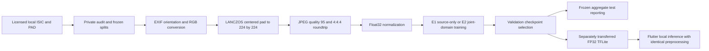

# Methodology

This is a conceptual diagram of the archived protocol, not an executed new pipeline. See six exact E2 JSON configurations in `training/configs/` and architecture diagrams in `figures/architecture/`. The corrected final E2 controller is `engine_amended_v2.py` within the six-model research run; archived earlier engines are historical.

E2 batches mix source and target domains according to each original configuration. Teacher/distillation and control details, parent budgets and amendment are recorded in `evaluation/reports/ENHANCED_MODEL_TEACHER_ANALYSIS.md` and `TEACHER_PROTOCOL_AMENDMENT.md`. The original teacher-superiority requirement failed; the exploratory amendment must remain visible.

Evaluation averages raw softmax probabilities over the predeclared exact-capture representatives within each declared lesion and then takes argmax in NV/MEL/BCC/SCC order. Image-level and lesion-level results are separately labeled. Conditional bootstrap intervals are inherited original results and require private grouping/prediction records to recompute. They are not training-seed confidence intervals.

The app accepts original JPEG or bounded 8-bit PNG, applies all eight EXIF orientations, uses RGB, centered gray-114 letterboxing with Pillow-compatible LANCZOS geometry, then a JPEG95 4:4:4 encode/decode roundtrip. Decode uses libjpeg-turbo 3.2.0 ISLOW with fancy upsampling and no ICC transform. Normalize each RGB pixel as `(float32(pixel)/255 - mean)/std`, with mean `[0.485,0.456,0.406]` and std `[0.229,0.224,0.225]`. Input is FP32 NHWC `[1,224,224,3]`; output is FP32 `[1,4]` logits. Apply one stable softmax, never twice. Prepared 224 JPEG evaluation inputs use the separately documented prepared path; do not preprocess twice.

App/device byte behavior, HEIC conversion, calibration and physical iPhone execution remain unverified. Exact Linux engineering probes do not establish universal mobile equivalence.
